<div align="center">

# Covebar

A dock and taskbar for Windows 10 and 11, with your apps, your music and small widgets on one bar.



</div>

## What it does

Covebar sits at the bottom or top of your screen and can take the place of the Windows taskbar. Pinned and running apps sit next to widgets you pick. Click a widget to open its card, or right-click it for its menu.

| Widget | What you get |
| --- | --- |
| **Apps** | Pinned and open apps, window previews, and a Start button with quick links to system tools |
| **Now Playing** | The track that's playing in any app, with play/pause and skip |
| **Timer & Stopwatch** | Countdowns from presets you choose, plus a stopwatch with laps |
| **Clock** | Time and date, with a calendar card |
| **Volume** and **Microphone** | Levels, mute, and a switch between output devices |
| **Brightness** | Screen brightness for supported displays |
| **Temperature** | CPU and GPU temperatures (see [Temperatures](#temperatures)) |
| **Currency** | Exchange rates between your favorite currencies |
| **Claude Usage** | How much of your Claude plan's limits you've used (see [Privacy](#privacy-and-network)) |
| **Recycle Bin** | How full the bin is; open or empty it |
| **Tray Icons** | The notification-area icons of your other apps |

To turn widgets on or off, or to change their order, right-click any widget and choose **Customize widgets…**

## Make it yours

Settings lets you choose:

- **Position**: bottom or top of the screen, centered or left-aligned
- **Shape**: a floating pill or a full-width strip, small or large
- **Look**: light, dark or follow Windows, with an Acrylic, Mica or Glass background
- **Auto-hide**: the bar slides away and comes back when you touch the screen edge or open Start
- **Hide the Windows taskbar** while Covebar is running
- **Start with Windows**

## Keyboard

| Keys | Action |
| --- | --- |
| <kbd>Win</kbd> + <kbd>1</kbd> … <kbd>9</kbd>, <kbd>0</kbd> | Open or switch to the app at that spot on the bar |
| <kbd>Win</kbd> + <kbd>Alt</kbd> + <kbd>Q</kbd> | Move focus to the bar. Use the arrow keys, Home and End to move, Enter to open, Esc to go back |
| <kbd>Shift</kbd> + <kbd>F10</kbd> or the Menu key | Open the menu of the focused item |
| <kbd>Win</kbd> + <kbd>Alt</kbd> + <kbd>M</kbd> | Mute or unmute the microphone |
| <kbd>Win</kbd> + <kbd>Alt</kbd> + <kbd>S</kbd> | Mute or unmute the speakers |

You can change or turn off any of these in Settings. Hold <kbd>Shift</kbd> while you right-click anywhere on the bar to get the bar's own menu, even when the pointer is over an app or widget.

## Install

Download `Covebar_x.y.z_x64-setup.exe` from the [latest release](https://github.com/hsh05/Covebar/releases/latest) and run it. It installs for your user only, so you don't need admin rights.

Covebar checks for new versions twice a day. When one is out, the bar's right-click menu and **Settings › About** offer to install it. Updates are signed, and Covebar won't install one whose signature doesn't match.

## Privacy and network

Covebar has no accounts, analytics or telemetry. It connects to the internet only for:

- **Updates**: the release files on this GitHub repository.
- **Currency**: rates from [open.er-api.com](https://open.er-api.com), with a jsDelivr-hosted rate list as a backup. Only while the Currency widget is on.
- **Claude Usage**: Anthropic's usage endpoint, only while that widget is on. Covebar reuses the Claude Code sign-in already on your PC (`%USERPROFILE%\.claude\.credentials.json`). It only reads that file, never changes it, and never writes the token to its log. Covebar may run `claude auth status` so Claude Code can renew an expired sign-in. The endpoint is undocumented, so the widget shows a message instead of numbers if the endpoint changes.

## Temperatures

Windows doesn't give apps reliable CPU and GPU temperatures. For real readings, run [LibreHardwareMonitor](https://github.com/LibreHardwareMonitor/LibreHardwareMonitor) in the background. Covebar reads it through WMI, or through its web server on port 8085. Without it, the widget shows CPU and memory load from Windows instead.

## Troubleshooting

- **The Windows taskbar didn't come back** after Covebar closed unexpectedly. Run `covebar.exe --restore-taskbar`, or start Covebar and quit it from its menu.
- **Logs** are in `%APPDATA%\dev.covebar.dock\logs\covebar.log`. Please attach this file when you report a bug.

## Build from source

You need [Node.js](https://nodejs.org) 22 or newer, [Rust](https://rustup.rs), and the [Tauri prerequisites for Windows](https://tauri.app/start/prerequisites/) (WebView2 and the MSVC build tools).

```bash
npm install
npm run tauri dev
```

| Command | What it does |
| --- | --- |
| `npm run tauri dev` | Run with hot reload |
| `npm run tauri build` | Build the installer into `src-tauri/target/release/bundle/nsis` |
| `npm test` | Frontend tests (Vitest) |
| `npm run check` | Type-check the Svelte code |
| `cargo test` (in `src-tauri`) | Backend tests |

Covebar is built with [Tauri 2](https://tauri.app), [Svelte 5](https://svelte.dev) and TypeScript, and its backend is Rust on the Windows API. To publish a release, push a `v*` tag. The release workflow then builds and signs the installer and the update file.

## License

[MIT](LICENSE) © 2026 hsh05
